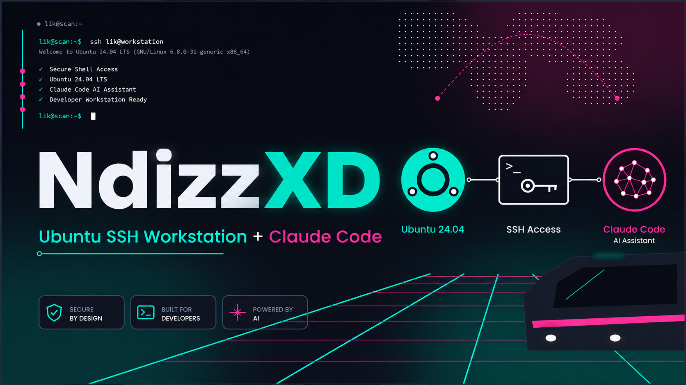

<p align="center">
  
</p>

<h1 align="center">NdizzXD — Railway Ubuntu SSH Server 🚂</h1>

<p align="center">
  <b>Your own cloud workstation on Railway.</b><br/>
  SSH in as <b>root</b> with <b>Claude Code</b> pre-installed and ready to go.
</p>

<p align="center">
  
  
  
  
  
</p>

---

NdizzXD is a Docker image built for **Railway**. It gives you an **Ubuntu 24.04** container with an **SSH server**, a **mandatory root password**, a full developer toolkit, and **Claude Code** pre-installed. Connect over SSH and use it as a portable cloud workstation, or run Claude Code for an AI-assisted terminal that stays on 24/7.

## ✨ Features

- 🐧 **Ubuntu 24.04** base image
- 🔑 **Direct root login** over SSH
- 🛡️ **Mandatory root password**: the container refuses to start if `ROOT_PASSWORD` is missing
- 👤 Optional secondary sudo user (`SSH_USERNAME` / `SSH_PASSWORD`)
- 🧠 **Claude Code** pre-installed, launched with the `cl` command inside a persistent tmux session
- 💾 Optional automatic backup of `/root/src` to a private GitHub repo
- 🎨 NdizzXD welcome banner on login
- 🛠️ Full network and dev toolkit (see [Included Packages](#-included-packages))

## ⚠️ Important Notice

**Railway runs Docker containers, not a VPS.** Anything stored in the container (files, installed packages, config changes, users) is **lost on every redeploy**. For persistent data, use a Railway Volume or the built-in GitHub backup (`GITHUB_TOKEN`).

## 🚀 Deploy to Railway

1. Click the **Deploy on Railway** button above, or fork this repo and connect it to a new Railway project.
2. Open **Settings → Variables** and set at least `ROOT_PASSWORD` (required).
3. Open **Settings → Networking → Public Networking** and add a **TCP Proxy** on port `22`.
4. **Redeploy.** Railway will give you a domain and port for SSH.

## 🔌 Connect via SSH

```bash
ssh root@<your-railway-domain> -p <port>
```

Type `yes` to accept the host key, then enter your `ROOT_PASSWORD`.

## 🧠 Using Claude Code

After connecting:

```bash
claude --version   # verify the install
cl                 # opens tmux session "claude" running Claude Code
```

Press `Ctrl+B`, then `D` to detach without closing the session.

### Auth token

The token is **never baked into the image**. Provide it in one of two ways:

- **Railway variable:** set `ANTHROPIC_AUTH_TOKEN`. It is rewritten into the settings on every container start, so edits apply on the next deploy.
- **Build arg:** `docker build --build-arg ANTHROPIC_AUTH_TOKEN="sk-or-..." -t ndiz-ssh .`

Need a GitHub or OpenRouter token? See the step-by-step guide in **[TOKENS.md](TOKENS.md)**.

## 🌱 Environment Variables

| Variable | Required | Default | Description |
|----------|:--------:|---------|-------------|
| `ROOT_PASSWORD` | ✅ | none | Password for the **root** user. The container will not start without it. |
| `SSH_USERNAME` | ⬜ | none | Optional secondary sudo user. Must be set together with `SSH_PASSWORD`. |
| `SSH_PASSWORD` | ⬜ | none | Password for the optional user. |
| `AUTHORIZED_KEYS` | ⬜ | none | SSH public key(s) for root key-based login. Password login stays on. |
| `ANTHROPIC_AUTH_TOKEN` | ⬜ | none | Token for Claude Code (OpenRouter or Anthropic). Applied on every deploy. |
| `GITHUB_TOKEN` | ⬜ | none | GitHub token with `repo` scope. When set, `/root/src` is backed up automatically to a **private** repo and restored on every redeploy. |
| `SYNC_INTERVAL` | ⬜ | `180` | Seconds between automatic `src` syncs (when `GITHUB_TOKEN` is set). |
| `APP_LANG` | ⬜ | `en` | Runtime message language: `en` or `fa`. |

> The Claude Code connection (`ANTHROPIC_BASE_URL`, model names, theme) is pre-configured in `claude-settings.json` and points to **OpenRouter** by default.

## 📦 Railway Template

This repo includes two Railway config files:

- **`railway.json`**: project config (Dockerfile builder, start command, restart policy, healthcheck). Used automatically when you deploy this repo.
- **`railway-template.json`**: a shareable template manifest with the service definition, variables, and the **TCP Proxy on port 22** pre-configured.

## 📦 Included Packages

| Category | Packages |
|----------|----------|
| Network | `curl`, `wget`, `iproute2`, `iputils-ping`, `net-tools`, `dnsutils`, `traceroute`, `whois`, `telnet`, `nmap` |
| Editors | `vim`, `nano`, `micro` |
| Monitoring | `htop`, `btop`, `ncdu`, `neofetch` |
| Terminal | `tmux`, `screen`, `less`, `tree`, `bat`, `ripgrep`, `fd-find`, `jq`, `zsh` |
| Archives | `unzip`, `zip`, `tar`, `gzip`, `bzip2`, `xz-utils`, `p7zip-full` |
| Dev | `git`, `build-essential`, `cmake`, `pkg-config`, `autoconf`, `automake`, `libtool`, `gcc`, `g++`, `python3`, `python3-pip`, `python3-venv`, `nodejs`, `npm` |
| Locales | `locales`, `language-pack-en`, `language-pack-fa` |

## 🔒 Security

- The root password is **mandatory**. Never deploy without `ROOT_PASSWORD`.
- Change the password after your first login.
- The Claude Code token is **never** stored in the image. Keep it private.
- Consider adding `AUTHORIZED_KEYS` for key-based access on top of the password.

## 🩺 Troubleshooting

- Make sure the TCP Proxy is configured on port `22`.
- Check the correct domain and port in the Railway dashboard.
- If the container crashes on start, confirm `ROOT_PASSWORD` is set.
- Remember that data is wiped on every redeploy unless you use a Volume or `GITHUB_TOKEN` backup.

## 📄 License

Released under the MIT License. See [LICENSE](LICENSE).

---

<p align="center">
  © NdizzXD · Built for Railway 🚂<br/>
</p>
